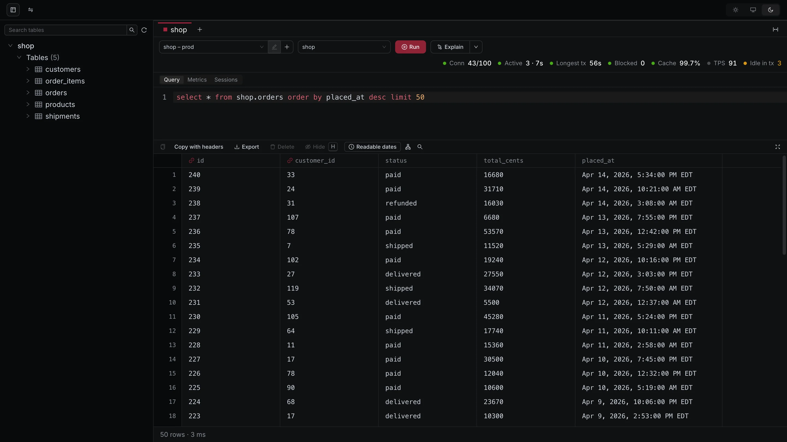

# PgClient

A Postgres desktop client built around problems I kept having: tunnels that reopen themselves, production that is red, servers in a file like `~/.kube/config`, and foreign keys you can follow without writing a join.

**[Download for Mac](https://github.com/MihaiPerju/pgclient/releases/latest/download/PgClient-mac-arm64.dmg)** · [Intel Mac](https://github.com/MihaiPerju/pgclient/releases/latest/download/PgClient-mac-intel.dmg) · [Windows](https://github.com/MihaiPerju/pgclient/releases/latest/download/PgClient-windows-setup.exe) · [Linux](https://github.com/MihaiPerju/pgclient/releases/latest/download/PgClient-linux.AppImage) · [Website](https://mihaiperju.github.io/pgclient/)

Postgres only, MIT, Tauri and Rust. Not yet signed by Apple: if macOS blocks the first launch, open System Settings → Privacy & Security and click Open Anyway.

## Development

    docker compose -f compose.test.yaml up -d --wait   # throwaway Postgres on :5435 for the tests
    npm install && npm --prefix web install
    npm run tauri dev                                  # the desktop app
    cargo test                                         # the core
    npm --prefix web test                              # the screens

Add `localhost:5435`, user `pgclient`, password `pgclient` as a server to try it against the test database.

## Layout

- `crates/core`: everything that touches a database. Knows nothing of windows or HTTP, so any shell can drive it.
- `src-tauri`: the desktop shell. Exposes the core as commands, and keeps passwords in the macOS Keychain.
- `web`: the UI. It talks only to the `Gateway` interface in `src/gateway.ts`, so a web server could stand in for Tauri without touching a screen.

## Servers file

Like kubectl reads `~/.kube/config`, the app reads `~/.pgclient/servers.json` by itself (or the file `$PGCLIENT_CONFIG` points to). Its servers appear in the picker, are read again whenever the window regains focus, and are changed only in the file. The format is `docs/servers.schema.json`, with an example in `docs/servers.example.json`.

A server may have an `environment`: `local`, `dev`, `staging` or `prod`. It is shown after the name, so `shop` in dev reads `shop - dev`, and the same name can be listed once in each. While it is chosen, the indigo accent everywhere turns teal for local, blue for dev and red for prod. Staging keeps the indigo.

A server may have a `tunnel`, such as a `kubectl port-forward`. It is started when you connect, only if the port is not already answering, and stopped when the app quits. If its port answers but nothing gets through, as when a forward outlives its login, it is started again once; a forward left by an earlier run counts, if it runs exactly the same command, while anything else on the port is left alone. If it fails, the app shows what the command said. Tunnels are read only from this file, never from an import.

A server with no `password` gets one from `~/.pgpass` (or `$PGPASSFILE`) the way psql does, so the file need hold no secrets. A line for any database of the server serves all of them. Anything wrong in the file is shown in the app and the rest still loads.

Servers can also be added in the app, with passwords in the macOS Keychain, or brought in once with **Import / export**, from a servers file or plain `postgres://` addresses, one to a line (`#name` on the end names it). An export leaves passwords out unless asked. Keep real servers files out of the repo: `*.pgclient.json` is ignored.

## Tabs

Each database is a tab. Drag a tab along its strip to put it in another place, onto the other pane to move it there, or to the right edge of a window that is not split to open a pane of its own. Esc gives a drag up. Without a pointer, Alt with the left or right arrow moves the tab in front a place.

## Suggestions

When a database is chosen, its tables, columns and foreign keys are loaded in one go and kept, so the editor can suggest from them before the first word is typed. After `from`, `join` or `on` the list opens by itself: tables after `from` and `join`, the columns of a table after its name or alias and a dot, and the columns of the statement's tables wherever a column can go (with the table in front when two of them have it). After `join … on`, the conditions the foreign keys give, either way round. The list is loaded again when the tables panel is refreshed, and after a statement that creates, alters, drops or renames something.

## Releasing

    npm run tauri build        # an app and installer for this machine, in target/release/bundle

For every platform at once: set the same new version in `src-tauri/tauri.conf.json` and `Cargo.toml`, then push a tag with a `v` in front of it.

    git tag v0.2.0 && git push origin v0.2.0

`.github/workflows/release.yml` builds macOS (Apple Silicon and Intel), Windows and Linux, and attaches the installers to a release, published once every platform is built. Each installer is also attached under a fixed name (`PgClient-mac-arm64.dmg`, `PgClient-mac-intel.dmg`, `PgClient-windows-setup.exe`, `PgClient-windows.msi`, `PgClient-linux.AppImage`, `PgClient-linux.deb`), so `https://github.com/MihaiPerju/pgclient/releases/latest/download/<name>` always downloads the newest; the site's Download button uses these. A tag that does not match the version in `tauri.conf.json` is refused. Builds are ad-hoc signed until an Apple Developer ID is added, so macOS blocks a downloaded copy's first launch; allow it under System Settings → Privacy & Security → Open Anyway.

An installed app is not given a terminal's `PATH`, so tunnel commands such as `kubectl` are found through the login shell's, asked for the first time a tunnel is needed.
